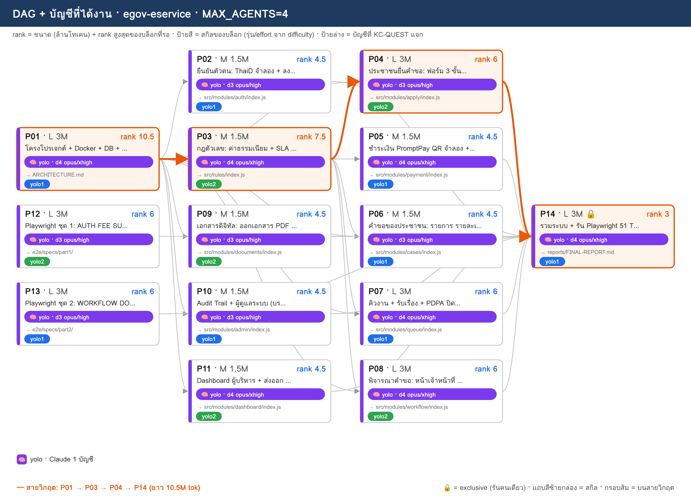
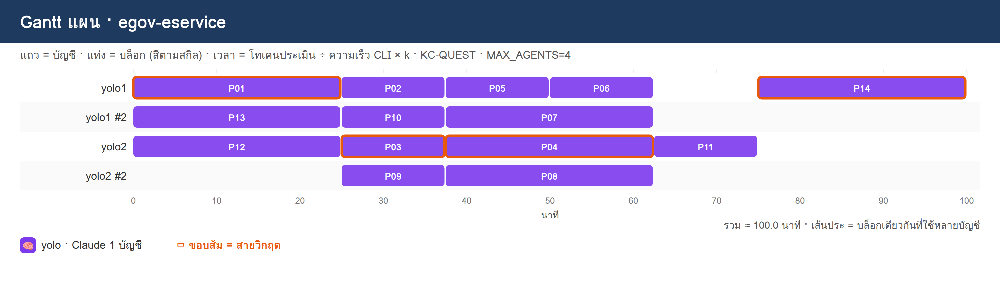

# PLAN · egov-eservice

**โจทย์:** เว็บ e-Service กลางของเทศบาลนครตัวอย่าง (สมมติ) ตามชุดโจทย์ /workspace/egov-brief: ประชาชนยื่น 3 บริการ (SV-01/02/03) จ่าย PromptPay QR จำลอง เจ้าหน้าที่ตรวจ/ตีกลับ/ส่งต่อ หัวหน้าอนุมัติ ออกเอกสารดิจิทัล + /verify, Dashboard, Audit, ผู้ดูแลระบบ ต้องทำตาม REQUIREMENTS (FR-01..FR-29, BR-01..BR-29, NFR-01..NFR-11) CONTRACT TEST-DATA DECISIONS ครบทุกข้อ รันด้วย `docker compose up --build` คำสั่งเดียว รองรับ TEST_MODE=1 (test hook) และ BUG_MODE=B01..B12 ตาม BUGS.md และมีชุด Playwright ครบ 51 TC ใน TEST-PLAN.md (ชื่อ test ขึ้นต้นด้วยรหัส TC) ทุกไฟล์อยู่ใน app/ · stack: Node 20 + Express 4 + better-sqlite3 + HTML render ฝั่งเซิร์ฟเวอร์ + JS ฝั่ง browser แบบ vanilla · ห้ามใช้ชื่อ/ตรา/โลโก้หน่วยงานจริง

วางแผนเมื่อ 15/11/2026 22:20 · MAX_AGENTS 4 · บัญชี yolo1, yolo2 · ตัวปรับเวลา k (ยังไม่มี calib.json → k=1)

> แผนนี้ยังไม่ได้รันจริง — KC-QUEST เลือกบัญชีจากโควตา แล้วจำลองเวลาตาม dependency

## 1) โควตาของแต่ละบัญชี

| บัญชี | แพลน | ใช้ไป 5 ชม. | ใช้ไปสัปดาห์ | headroom | รีเซ็ต/หมดอายุ (ชม.) | U | slot | ที่มา |
|---|---|---|---|---|---|---|---|---|
| yolo1 | default | 10% | 13% | **87%** | 109.6 | 0.18 | 3 | team.py quota |
| yolo2 | default | 8% | 1% | **92%** | 141.7 | 0.145 | 3 | team.py quota |

## 2) DAG + สกิล + บัญชี

**สายวิกฤต:** P01 → P03 → P04 → P14 · ยาว 10.5M tok

## 3) ตารางแจกงาน (เหตุผล KC-QUEST ทุกบล็อก)

| บล็อก | สกิล | ชื่อ | ขนาด · c | รอ | rank | บัญชี (บทบาท) | เริ่ม–จบ (นาที) | เหตุผล KC-QUEST |
|---|---|---|---|---|---|---|---|---|
| **P01** | 🧠 yolo | โครงโปรเจกต์ + Docker + DB + seed + test hook | L · 3 | – | 10.5 | yolo1 (ทำ) | 0.0–25.0 | ทำ: yolo1 34.8 (U=0.18 F=0.011 S=0.822 S=1.0 L=0.0) · 3.00M ≈ 5ชม. 7.8% / สัปดาห์ 0.98% · อันดับ 2 yolo2 33.6 |
| P12 | 🧠 yolo | Playwright ชุด 1: AUTH FEE SUBMIT UPLOAD PAY QUEUE SLA NOTI (22 TC) | L · 3 | – | 6 | yolo2 (ทำ) | 0.0–25.0 | ทำ: yolo2 27.2 (U=0.145 F=0.01 S=0.842 S=0.571 L=0.0) · 3.00M ≈ 5ชม. 7.8% / สัปดาห์ 0.98% · อันดับ 2 yolo1 23.8 |
| P13 | 🧠 yolo | Playwright ชุด 2: WORKFLOW DOC PDPA DASH AUDIT RBAC NFR (29 TC) | L · 3 | – | 6 | yolo1 (ทำ) | 0.0–25.0 | ทำ: yolo1 23.8 (U=0.18 F=0.011 S=0.744 S=0.571 L=0.333) · 3.00M ≈ 5ชม. 7.8% / สัปดาห์ 0.98% · อันดับ 2 yolo2 22.7 |
| **P03** | 🧠 yolo | กฎตัวเลข: ค่าธรรมเนียม + SLA วันทำการ + ระดับเตือน | M · 1.5 | P01 | 7.5 | yolo2 (ทำ) | 25.0–37.5 | ทำ: yolo2 28.7 (U=0.145 F=0.005 S=0.803 S=0.714 L=0.0) · 1.50M ≈ 5ชม. 3.9% / สัปดาห์ 0.49% · อันดับ 2 yolo1 28.6 |
| P02 | 🧠 yolo | ยืนยันตัวตน: ThaiD จำลอง + ลงทะเบียน + SSO เจ้าหน้าที่ | M · 1.5 | P01 | 4.5 | yolo1 (ทำ) | 25.0–37.5 | ทำ: yolo1 24.3 (U=0.18 F=0.006 S=0.705 S=0.429 L=0.0) · 1.50M ≈ 5ชม. 3.9% / สัปดาห์ 0.49% · อันดับ 2 yolo2 20.5 |
| P09 | 🧠 yolo | เอกสารดิจิทัล: ออกเอกสาร PDF ลายเซ็น HMAC + /verify | M · 1.5 | P01 | 4.5 | yolo2 (ทำ) | 25.0–37.5 | ทำ: yolo2 20.5 (U=0.145 F=0.005 S=0.764 S=0.429 L=0.333) · 1.50M ≈ 5ชม. 3.9% / สัปดาห์ 0.49% · อันดับ 2 yolo1 20.4 |
| P10 | 🧠 yolo | Audit Trail + ผู้ดูแลระบบ (บริการ วันหยุด ผู้ใช้) | M · 1.5 | P01 | 4.5 | yolo1 (ทำ) | 25.0–37.5 | ทำ: yolo1 20.4 (U=0.18 F=0.006 S=0.666 S=0.429 L=0.333) · 1.50M ≈ 5ชม. 3.9% / สัปดาห์ 0.49% · อันดับ 2 yolo2 16.5 |
| **P04** | 🧠 yolo | ประชาชนยื่นคำขอ: ฟอร์ม 3 ขั้น ร่าง ไฟล์แนบ เอกสารบังคับ | L · 3 | P01, P03 | 6 | yolo2 (ทำ) | 37.5–62.5 | ทำ: yolo2 24.9 (U=0.145 F=0.01 S=0.686 S=0.571 L=0.0) · 3.00M ≈ 5ชม. 7.8% / สัปดาห์ 0.98% · อันดับ 2 yolo1 24.8 |
| P07 | 🧠 yolo | คิวงาน + รับเรื่อง + PDPA ปิดบัง/แสดงเลขเต็ม + แจ้งเตือน | L · 3 | P01, P03 | 6 | yolo1 (ทำ) | 37.5–62.5 | ทำ: yolo1 24.8 (U=0.18 F=0.012 S=0.588 S=0.571 L=0.0) · 3.00M ≈ 5ชม. 7.8% / สัปดาห์ 0.98% · อันดับ 2 yolo2 20.4 |
| P08 | 🧠 yolo | พิจารณาคำขอ: หน้าเจ้าหน้าที่ ตีกลับ ส่งต่อ อนุมัติ หัวหน้า ไฟล์แนบ | L · 3 | P01, P03 | 6 | yolo2 (ทำ) | 37.5–62.5 | ทำ: yolo2 20.4 (U=0.145 F=0.01 S=0.608 S=0.571 L=0.333) · 3.00M ≈ 5ชม. 7.8% / สัปดาห์ 0.98% · อันดับ 2 yolo1 20.3 |
| P05 | 🧠 yolo | ชำระเงิน PromptPay QR จำลอง + เลขคำขอ + ใบเสร็จ | M · 1.5 | P01, P03 | 4.5 | yolo1 (ทำ) | 37.5–50.0 | ทำ: yolo1 18.7 (U=0.18 F=0.006 S=0.549 S=0.429 L=0.333) · 1.50M ≈ 5ชม. 3.9% / สัปดาห์ 0.49% · อันดับ 2 yolo2 14.2 |
| P06 | 🧠 yolo | คำขอของประชาชน: รายการ รายละเอียด ยกเลิก ส่งแก้ไข 168 ชม. | M · 1.5 | P01, P03 | 4.5 | yolo1 (ทำ) | 50.0–62.5 | ทำ: yolo1 18.1 (U=0.18 F=0.006 S=0.51 S=0.429 L=0.333) · 1.50M ≈ 5ชม. 3.9% / สัปดาห์ 0.49% · อันดับ 2 yolo2 14.2 |
| P11 | 🧠 yolo | Dashboard ผู้บริหาร + ส่งออก Excel/PDF | M · 1.5 | P01 | 4.5 | yolo2 (ทำ) | 62.5–75.0 | ทำ: yolo2 20.9 (U=0.145 F=0.005 S=0.569 S=0.429 L=0.0) · 1.50M ≈ 5ชม. 3.9% / สัปดาห์ 0.49% · อันดับ 2 yolo1 20.8 |
| **P14** | 🧠 yolo | รวมระบบ + รัน Playwright 51 TC + BUG_MODE B01–B12 | L · 3 | P02, P04, P05, P06, P07, P08, P09, P10, P11, P12, P13 | 3 | yolo1 (ทำ) | 75.0–100.0 | ทำ: yolo1 18.2 (U=0.18 F=0.012 S=0.432 S=0.286 L=0.0) · 3.00M ≈ 5ชม. 7.8% / สัปดาห์ 0.98% · อันดับ 2 yolo2 17.7 |

## 4) Gantt แผน

## 5) รอบแจกงาน

| นาทีที่ | บล็อกที่เริ่ม |
|---|---|
| 0 | P01→yolo1, P12→yolo2, P13→yolo1 |
| 25 | P03→yolo2, P02→yolo1, P09→yolo2, P10→yolo1 |
| 37.5 | P04→yolo2, P07→yolo1, P08→yolo2, P05→yolo1 |
| 50 | P06→yolo1 |
| 62.5 | P11→yolo2 |
| 75 | P14→yolo1 |

## 6) สรุป

- บล็อก 14 · แจกได้ 14 · agent พร้อมกันสูงสุด 4/4
- เวลาประมาณ 100.0 นาที (แท่ง Gantt) · ไฟล์ผลของทีม: `/workspace/plans/egov-eservice/app/`

ต่อไป: `dagplan.py export egov-eservice` → `dagplan.py run egov-eservice` → `dagplan.py report egov-eservice`
