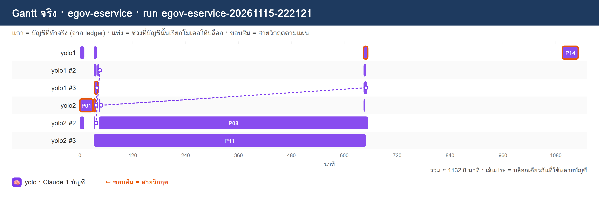
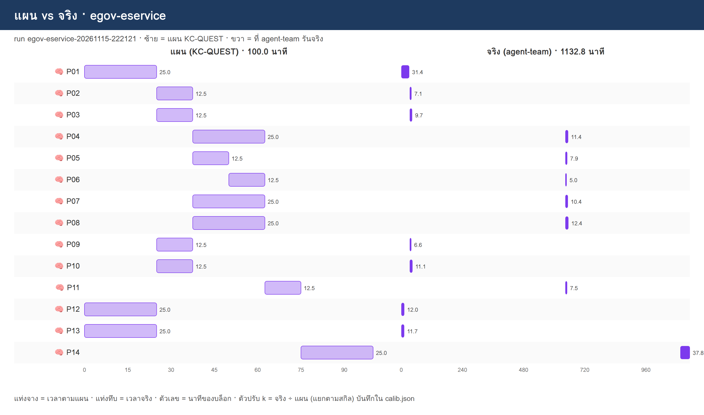

# REPORT · egov-eservice

**run:** `egov-eservice-20261115-222121` · `/workspace/.agent-team/egov-eservice-20261115-222121` · โจทย์: เว็บ e-Service กลางของเทศบาลนครตัวอย่าง (สมมติ) ตามชุดโจทย์ /workspace/egov-brief: ประชาชนยื่น 3 บริการ (SV-01/02/03) จ่าย PromptPay QR จำลอง เจ้าหน้าที่ตรวจ/ตีกลับ/ส่งต่อ หัวหน้าอนุมัติ ออกเอกสารดิจิทัล + /verify, Dashboard, Audit, ผู้ดูแลระบบ ต้องทำตาม REQUIREMENTS (FR-01..FR-29, BR-01..BR-29, NFR-01..NFR-11) CONTRACT TEST-DATA DECISIONS ครบทุกข้อ รันด้วย `docker compose up --build` คำสั่งเดียว รองรับ TEST_MODE=1 (test hook) และ BUG_MODE=B01..B12 ตาม BUGS.md และมีชุด Playwright ครบ 51 TC ใน TEST-PLAN.md (ชื่อ test ขึ้นต้นด้วยรหัส TC) ทุกไฟล์อยู่ใน app/ · stack: Node 20 + Express 4 + better-sqlite3 + HTML render ฝั่งเซิร์ฟเวอร์ + JS ฝั่ง browser แบบ vanilla · ห้ามใช้ชื่อ/ตรา/โลโก้หน่วยงานจริง

## ตารางบล็อก (แผน vs จริง)

| บล็อก | สกิล | บัญชีแผน | บัญชีจริง | นาทีแผน | นาทีจริง | tokens (ไม่รวม cache read) | ครั้ง | สถานะ | ไฟล์ผล |
|---|---|---|---|---|---|---|---|---|---|
| **P01** | 🧠 yolo | yolo1(ทำ) | yolo2(ทำ) | 25.00 | 31.38 | 558,310 | 1 | ok | ✅ ARCHITECTURE.md |
| P02 | 🧠 yolo | yolo1(ทำ) | yolo1(ทำ) | 12.50 | 7.13 | 190,896 | 2 | ok | ✅ src/modules/auth/index.js |
| **P03** | 🧠 yolo | yolo2(ทำ) | yolo2(ทำ), yolo1(ทำ) | 12.50 | 9.68 | 240,962 | 2 | ok | ✅ src/rules/index.js |
| **P04** | 🧠 yolo | yolo2(ทำ) | yolo1(ทำ) | 25.00 | 11.40 | 275,413 | 1 | ok | ✅ src/modules/apply/index.js |
| P05 | 🧠 yolo | yolo1(ทำ) | yolo1(ทำ) | 12.50 | 7.87 | 221,919 | 1 | ok | ✅ src/modules/payment/index.js |
| P06 | 🧠 yolo | yolo1(ทำ) | yolo2(ทำ) | 12.50 | 4.98 | 200,193 | 1 | ok | ✅ src/modules/cases/index.js |
| P07 | 🧠 yolo | yolo1(ทำ) | yolo2(ทำ), yolo1(ทำ) | 25.00 | 10.38 | 498,048 | 2 | ok | ✅ src/modules/queue/index.js |
| P08 | 🧠 yolo | yolo2(ทำ) | yolo2(ทำ) | 25.00 | 12.37 | 584,599 | 2 | ok | ✅ src/modules/workflow/index.js |
| P09 | 🧠 yolo | yolo2(ทำ) | yolo1(ทำ) | 12.50 | 6.58 | 195,096 | 2 | ok | ✅ src/modules/documents/index.js |
| P10 | 🧠 yolo | yolo1(ทำ) | yolo2(ทำ), yolo1(ทำ) | 12.50 | 11.08 | 157,016 | 2 | ok | ✅ src/modules/admin/index.js |
| P11 | 🧠 yolo | yolo2(ทำ) | yolo2(ทำ) | 12.50 | 7.48 | 400,073 | 3 | ok | ✅ src/modules/dashboard/index.js |
| P12 | 🧠 yolo | yolo2(ทำ) | yolo1(ทำ) | 25.00 | 11.97 | 272,502 | 1 | ok | ✅ e2e/specs/part1/ |
| P13 | 🧠 yolo | yolo1(ทำ) | yolo2(ทำ) | 25.00 | 11.72 | 288,388 | 1 | ok | ✅ e2e/specs/part2/ |
| **P14** | 🧠 yolo | yolo1(ทำ) | yolo1(ทำ) | 25.00 | 37.75 | 236,573 | 1 | ok | ✅ reports/FINAL-REPORT.md |

- tokens รวมของบล็อก **4,319,988** = ผลรวมจาก ledger ของ run (22 การเรียก) **4,319,988** ✅ ตรงกัน
- การเรียกที่ไม่ใช่บล็อก (ตรวจความพร้อม ฯลฯ): 0 ครั้ง · 0 tokens (ไม่นับในตาราง)
- เวลารวม: แผน 100.0 นาที · จริง 1132.8 นาที
- บล็อกเสร็จ 14/14

## ภาพ

## ความต่างระหว่างแผนกับของจริง

- P01: แผน yolo1(ทำ) → จริง yolo2(ทำ)
- P03: แผน yolo2(ทำ) → จริง yolo2(ทำ), yolo1(ทำ)
- P04: แผน yolo2(ทำ) → จริง yolo1(ทำ)
- P06: แผน yolo1(ทำ) → จริง yolo2(ทำ)
- P07: แผน yolo1(ทำ) → จริง yolo2(ทำ), yolo1(ทำ)
- P09: แผน yolo2(ทำ) → จริง yolo1(ทำ)
- P10: แผน yolo1(ทำ) → จริง yolo2(ทำ), yolo1(ทำ)
- P12: แผน yolo2(ทำ) → จริง yolo1(ทำ)
- P13: แผน yolo1(ทำ) → จริง yolo2(ทำ)
- (export ส่งเป็นฝั่ง yolo/cyolo ไม่ผูกบัญชี เพื่อให้ failover ของ agent-team ทำงาน → agent-team เลือกบัญชีในฝั่งเองตามโหลด/โควตา ดู references/run.md)
- event worker_stop:  → โควตา 80% ≥ เกณฑ์ 80%
- event worker_switch: P05 yolo1→yolo2 บัญชี yolo1 หยุดรับงาน: โควตา 80% ≥ เกณฑ์ 80%
- event worker_switch: P08 yolo1→yolo2 บัญชี yolo1 หยุดรับงาน: โควตา 80% ≥ เกณฑ์ 80%
- event worker_switch: P11 yolo1→yolo2 บัญชี yolo1 หยุดรับงาน: โควตา 80% ≥ เกณฑ์ 80%
- event worker_stop:  → โควตา 101% ≥ เกณฑ์ 80%
- event worker_switch: P14 yolo2→ บัญชี yolo2 หยุดรับงาน: โควตา 101% ≥ เกณฑ์ 80%
- event worker_switch: P05 yolo2→ บัญชี yolo2 หยุดรับงาน: โควตา 101% ≥ เกณฑ์ 80%
- event worker_switch: P04 yolo2→ บัญชี yolo2 หยุดรับงาน: โควตา 101% ≥ เกณฑ์ 80%
- event worker_switch: P06 yolo2→ บัญชี yolo2 หยุดรับงาน: โควตา 101% ≥ เกณฑ์ 80%

## ตัวปรับเวลา k (calib.json)

`/workspace/plans/calib.json`: {"yolo": 0.6925}

k = นาทีจริง ÷ นาทีแผน (ก่อนคูณ k) แยกตามสกิล · `plan` ครั้งถัดไปคูณเวลาแต่ละบล็อกด้วย k ของสกิลนั้น
